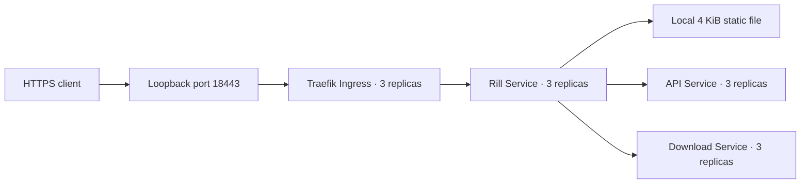

# Rill behind Kubernetes HTTPS ingress

This lab runs Rill v0.1.0 behind Traefik 3.8.0 on Kubernetes 1.37.0. It uses one
control plane and three worker nodes. Each worker runs one Traefik pod, one
Rill pod and one pod from each of two origin services.



Traefik terminates TLS. Rill serves `/static.bin` and forwards `/api/` and
`/downloads/` to two separate NGINX origin Deployments. Kubernetes
readiness probes gate traffic to the pods, and Rill checks the two upstream
Services every two seconds. A rolling update replaces one Rill replica at a
time while keeping three available. A PodDisruptionBudget allows one voluntary
eviction.

## Throughput and latency

| Workload | Connections | Requests/s | p95 | p99 |
|---|---:|---:|---:|---:|
| Serve a 4 KiB file | 64 | 30,334 | 4.10 ms | 5.58 ms |
| Proxy a 256 KiB download | 64 | 9,567 | 11.81 ms | 14.73 ms |
| Mixed traffic | 64 | 23,763 | 5.15 ms | 6.84 ms |
| Mixed traffic | 256 | 24,513 | 20.20 ms | 24.82 ms |

The mixed workload was 70% static 4 KiB files, 20% proxied 4 KiB API
responses and 10% proxied 256 KiB downloads. Each number is the median of
three 30-second rounds after a five-second warmup. wrk validated all
7,949,870 measured responses, with zero invalid responses or transport errors.
[Individual rounds](rounds.csv)

The cluster and load generator shared one AMD Ryzen 9 9950X3D host running
Ubuntu on WSL2. Eight wrk threads used CPUs 16, 18, 20, 22, 24, 26, 28 and 30.
TLS, local port forwarding, Kubernetes networking, Rill and the origins
all contributed to the measured latency. The results describe this complete
deployment on one machine. The steady-state run preceded the rollout spread
rule correction, with the same replica placement across the three workers.

## Restart under load

During a 60-second mixed run with 64 connections, Kubernetes replaced all
three Rill pods. The restart began after eight seconds of traffic and the
Deployment reported rollout complete about ten seconds later. The client
validated 1,422,837 responses at 23,704 requests/s and 5.21 ms p95. wrk
recorded zero invalid responses and zero transport errors in that run.
[Rollout sample](rollout.csv)

The first restart exposed a scheduling issue. With a tainted control plane
counted in the topology spread and selectors shared across ReplicaSets, the
surge pod stayed pending. The original pods kept serving. The manifest now
excludes untolerated nodes and spreads pods by Deployment revision. The
60-second measurement used that corrected manifest.

## Reproduce

Use Linux with kind, Podman, kubectl, Helm, OpenSSL, Python 3 and a
Lua-enabled wrk. Reserve port 18443 on loopback. Run from the repository root.

```sh
lab="$PWD/target/kube-benchmark"
mkdir -p "$lab"
export KUBECONFIG="$lab/kubeconfig"
export KIND_EXPERIMENTAL_PROVIDER=podman
kind create cluster --name rill-benchmark --image kindest/node:v1.37.0 \
  --config bench/kubernetes/kind.yaml --kubeconfig "$KUBECONFIG"
bench/kubernetes/deploy.sh "$lab"

curl --noproxy '*' --resolve rill-bench:18443:127.0.0.1 --cacert "$lab/tls.pem" \
  --fail --silent --show-error https://rill-bench:18443/api/payload.bin | cmp - "$lab/api.bin"

python3 bench/kubernetes/run.py "$lab" --cpus 16,18,20,22,24,26,28,30
python3 bench/kubernetes/run.py "$lab" --cpus 16,18,20,22,24,26,28,30 --seconds 60 --rollout
```

Choose one logical CPU per physical core from the CPUs available to the load
generator. The benchmark uses its private host alias file. The certificate is
self-signed and stays in the lab directory. The curl preflight checks the
certificate and hostname. wrk measures TLS traffic without certificate
verification.

The cluster context and kubeconfig are dedicated to this lab. To remove the
cluster after testing, run `kind delete cluster --name rill-benchmark` with
the same Podman provider and kubeconfig.
