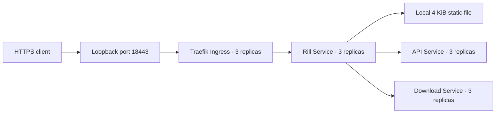

# Rill behind Kubernetes HTTPS ingress

This lab runs Rill behind Traefik 3.8.0 on Kubernetes 1.37.0. It uses one
control plane and three worker nodes. Each worker runs one Traefik pod, one
Rill pod and one pod from each of two origin services.



Traefik terminates TLS. Rill serves `/static.bin` and forwards `/api/` and
`/downloads/` to two separate NGINX origin Deployments. Kubernetes
readiness probes gate traffic to the pods, and Rill checks the two upstream
Services every two seconds. A rolling update replaces one Rill replica at a
time while keeping three available. A PodDisruptionBudget allows one voluntary
eviction.

## Automatic worker defaults

On this cluster each Rill pod had a two-CPU quota and could run across a
wider set of CPUs. Both Rill images ran with the two worker environment
variables unset. The previous build used two network workers and one blocking
worker. All three pods running the new build reported one network worker and
a limit of two blocking workers. The CPU quota, replica count, ingress,
origins and traffic mix were the same. [Worker selection change](https://github.com/dperox/rill/commit/2bc8e16)

| Workload | Connections | Previous req/s | New req/s | NGINX req/s | Previous p95 | New p95 | NGINX p95 |
|---|---:|---:|---:|---:|---:|---:|---:|
| Static 4 KiB | 64 | 30,985 | 36,744 | 32,275 | 3.99 ms | 3.47 ms | 4.03 ms |
| Proxied download 256 KiB | 64 | 9,427 | 11,008 | 10,219 | 12.16 ms | 10.48 ms | 10.59 ms |
| Mixed | 64 | 23,275 | 27,550 | 25,940 | 5.38 ms | 4.50 ms | 4.60 ms |
| Mixed | 256 | 24,523 | 28,233 | 26,309 | 20.27 ms | 17.63 ms | 19.03 ms |

The new defaults served 18.4% more mixed requests per second at 64 connections
and 15.1% more at 256. In this lab they exceeded NGINX throughput by 6.2% and
7.3% respectively.

These are medians of three ten-second rounds per workload with three-second
warmups. We ran the previous defaults first, then alternated the new build and
NGINX 1.30.8. All 8,643,767 measured responses passed validation with zero
transport errors. [All 36 rounds](worker-defaults-rounds.csv)

## Linux worker scheduling

We kept two network workers, two blocking workers and a two-CPU limit per
Rill pod. We measured v0.1.0 in the same cluster, then alternated the final
build and NGINX 1.30.8 in each workload. The image was the only
deployment setting that changed. [Measured Rill revision](https://github.com/dperox/rill/commit/7f87daf)

| Workload | Connections | v0.1.0 req/s | New Rill req/s | NGINX req/s | v0.1.0 p95 | New Rill p95 | NGINX p95 |
|---|---:|---:|---:|---:|---:|---:|---:|
| Static 4 KiB | 64 | 29,900 | 31,494 | 32,601 | 4.24 ms | 3.93 ms | 3.78 ms |
| Proxied download 256 KiB | 64 | 9,492 | 10,321 | 10,178 | 11.81 ms | 11.05 ms | 11.12 ms |
| Mixed | 64 | 23,569 | 25,116 | 25,935 | 5.24 ms | 4.83 ms | 4.92 ms |
| Mixed | 256 | 24,110 | 25,420 | 26,338 | 20.81 ms | 20.07 ms | 19.08 ms |

Mixed throughput rose 6.6% at 64 connections and 5.4% at 256, bringing
Rill within 3.2–3.5% of NGINX. Downloads improved 8.7% over v0.1.0
and finished 1.4% ahead of NGINX.

Each entry is the median of three ten-second measurements after a three-second
warmup. The client checked all 8,303,881 responses and recorded zero HTTP,
body-validation or transport errors. These short, warm runs share one WSL2
host. [All 36 rounds, including p99](scheduler-rounds.csv)

An earlier v0.1.0 control kept both CPUs and both blocking workers. At 64 mixed
connections, one network worker handled 27,655 and 27,493 requests/s in two
ten-second rounds. Two network workers handled 23,924 and 23,911. One worker
per pod remains a useful setting for this particular traffic mix.

### What changed inside the pod

In v0.1.0, two threads ran the HTTP connections and two more ran Tokio’s
shared I/O scheduler. A socket becoming ready could wake a different thread
to process its request. Both network workers now accept connections from
the same listening socket.
Each worker drives I/O for the connections it accepts. Each also gets one
blocking worker for filesystem work and DNS in this two-CPU setup.
[Worker implementation](../../src/plain/workers.rs)

We sampled Linux `/proc/1/task/*/schedstat` across all three Rill pods before
and after a separate ten-second mixed run at 64 connections. Frontend CPU
includes filesystem work. Traefik, the origins and wrk run outside these
processes. Each row below represents one trace, and CPU time includes the
short interval needed to collect the counters.

| Build | Threads per pod | Valid responses | Frontend CPU per response | Linux scheduling slices per response |
|---|---:|---:|---:|---:|
| Rill v0.1.0 | 6 | 242,022 | 209 µs | 2.91 |
| Rill 7f87daf | 4 | 258,001 | 152 µs | 1.39 |

That is 27% less frontend CPU per response and 52% fewer scheduling slices
per response in the trace. [Per-thread counter deltas](scheduler-trace.csv)

## Rill vs. NGINX

Rill v0.1.0 and NGINX 1.30.8 ran in the same cluster. Each frontend had
three replicas, two network workers per replica, and limits of two CPUs and
256 MiB per pod. Both served the same files and forwarded requests to the
same origins through Traefik. Each frontend had its own HTTPS hostname. The
client sent traffic to one frontend at a time and reversed the test order
in the second round.

NGINX used its default proxy response buffering. Rill streamed proxied
responses. Both reused HTTP/1.1 connections to the origins. The figures
include TLS, ingress, Kubernetes networking and origin work on this host.

| Workload | Connections | Rill req/s | NGINX req/s | Rill p95 | NGINX p95 |
|---|---:|---:|---:|---:|---:|
| Serve a 4 KiB file | 64 | 30,587 | 32,838 | 4.10 ms | 3.75 ms |
| Proxy a 256 KiB download | 64 | 9,590 | 10,220 | 12.15 ms | 10.34 ms |
| Mixed traffic | 64 | 23,527 | 26,128 | 5.35 ms | 4.64 ms |
| Mixed traffic | 256 | 24,377 | 26,531 | 20.32 ms | 18.93 ms |

Medians of three 10-second rounds following a three-second warmup. The
comparison validated 5,550,691 responses with zero errors.
[All rounds, including p99](comparison-rounds.csv)

### Restarts during mixed traffic

Two 45-second runs per server used 64 connections. The rolling restart began eight
seconds into the run and replaced all three replicas.

| Frontend | Round | Rollout time | Validated responses | Requests/s | p95 | Invalid responses | Transport errors |
|---|---:|---:|---:|---:|---:|---:|---:|
| Rill | 1 | 9.29 s | 1,061,165 | 23,560 | 5.31 ms | 0 | 0 |
| NGINX | 1 | 9.11 s | 390,465 | 8,686 | 4.62 ms | 1097 | 64 |
| Rill | 2 | 9.01 s | 1,068,560 | 23,725 | 5.21 ms | 0 | 0 |
| NGINX | 2 | 11.80 s | 398,950 | 8,883 | 5.05 ms | 1453 | 0 |

The second NGINX run identified all 1,453 HTTP errors as 502 responses.
Fresh HTTPS requests passed after both rollouts. These results cover the
pod shutdown behavior and ingress configuration used in this lab.
Rollout latency measures completed responses.
[Rollout samples](comparison-rollout.csv)

## Rill baseline

| Workload | Connections | Requests/s | p95 | p99 |
|---|---:|---:|---:|---:|
| Serve a 4 KiB file | 64 | 30,334 | 4.10 ms | 5.58 ms |
| Proxy a 256 KiB download | 64 | 9,567 | 11.81 ms | 14.73 ms |
| Mixed traffic | 64 | 23,763 | 5.15 ms | 6.84 ms |
| Mixed traffic | 256 | 24,513 | 20.20 ms | 24.82 ms |

The mixed workload was 70% static 4 KiB files, 20% proxied 4 KiB API
responses and 10% proxied 256 KiB downloads. Each number is the median of
three 30-second rounds after a five-second warmup. wrk validated all
7,949,870 measured responses, with zero invalid responses or transport errors.
[Individual rounds](rounds.csv)

The cluster and load generator shared one AMD Ryzen 9 9950X3D host running
Ubuntu on WSL2. Eight wrk threads used CPUs 16, 18, 20, 22, 24, 26, 28 and 30.
TLS, local port forwarding, Kubernetes networking, Rill and the origins
all contributed to the measured latency. The results describe this complete
deployment on one machine. The steady-state run preceded the rollout spread
rule correction, with the same replica placement across the three workers.

## Restart under load

During a 60-second mixed run with 64 connections, Kubernetes replaced all
three Rill pods. The restart began after eight seconds of traffic and the
Deployment reported rollout complete about ten seconds later. The client
validated 1,422,837 responses at 23,704 requests/s and 5.21 ms p95. wrk
recorded zero invalid responses and zero transport errors in that run.
[Rollout sample](rollout.csv)

The first restart exposed a scheduling issue. With a tainted control plane
counted in the topology spread and selectors shared across ReplicaSets, the
surge pod stayed pending. The original pods kept serving. The manifest now
excludes untolerated nodes and spreads pods by Deployment revision. The
60-second measurement used that corrected manifest.

## Reproduce

Use Linux with kind, Podman, kubectl, Helm, OpenSSL, Python 3 and a
Lua-enabled wrk. Reserve port 18443 on loopback. Run from the repository root.

```sh
lab="$PWD/target/kube-benchmark"
mkdir -p "$lab"
export KUBECONFIG="$lab/kubeconfig"
export KIND_EXPERIMENTAL_PROVIDER=podman
kind create cluster --name rill-benchmark --image kindest/node:v1.37.0 \
  --config bench/kubernetes/kind.yaml --kubeconfig "$KUBECONFIG"
bench/kubernetes/deploy.sh "$lab"

curl --noproxy '*' --resolve rill-bench:18443:127.0.0.1 --cacert "$lab/tls.pem" \
  --fail --silent --show-error https://rill-bench:18443/api/payload.bin | cmp - "$lab/api.bin"

# Match the explicit worker counts in the historical v0.1.0 runs.
kubectl -n rill-bench set env deploy/rill TOKIO_WORKER_THREADS=2 RILL_BLOCKING_THREADS=2
kubectl -n rill-bench rollout status deploy/rill
python3 bench/kubernetes/run.py "$lab" --cpus 16,18,20,22,24,26,28,30
python3 bench/kubernetes/run.py "$lab" --cpus 16,18,20,22,24,26,28,30 --seconds 60 --rollout
```

For the head-to-head comparison, deploy the NGINX frontend in the same lab
and run both servers with alternating order.

```sh
bench/kubernetes/deploy-nginx.sh "$lab"
python3 bench/kubernetes/run.py "$lab" --compare-nginx --seconds 10 --warmup 3
python3 bench/kubernetes/run.py "$lab" --compare-nginx --seconds 45 --warmup 3 --rollout
```

Choose one logical CPU per physical core from the CPUs available to the load
generator. The benchmark uses its private host alias file. The self-signed TLS certificates and keys stay
in the lab directory. The curl preflight checks the certificate and hostname. wrk measures TLS traffic without certificate
verification.

### Reproduce the scheduling comparison

Use the cluster above with both frontends deployed. The image tag below is
local to the lab. The benchmark manifest pins the public v0.1.0 release.

```sh
rev=7f87daf
image="localhost/rill:scheduling-$rev"
git worktree add --detach "$lab/src-$rev" "$rev"
podman build -t "$image" -f "$lab/src-$rev/deploy/Dockerfile" "$lab/src-$rev"
podman save -o "$lab/rill-$rev.tar" "$image"
kind load image-archive --name rill-benchmark "$lab/rill-$rev.tar"
original=$(kubectl -n rill-bench get deploy rill -o jsonpath='{.spec.template.spec.containers[0].image}')
kubectl -n rill-bench set image deploy/rill "rill=$image"
kubectl -n rill-bench rollout status deploy/rill
mkdir -p "$lab/$rev" "$lab/release"
cp "$lab/hosts" "$lab/$rev/hosts"
cp "$lab/hosts" "$lab/release/hosts"
python3 bench/kubernetes/run.py "$lab/$rev" --seconds 10 --warmup 3 --compare-nginx
kubectl -n rill-bench set image deploy/rill "rill=$original"
kubectl -n rill-bench rollout status deploy/rill
python3 bench/kubernetes/run.py "$lab/release" --seconds 10 --warmup 3
```

For the automatic-default comparison, use the build and kind image-loading
commands above for both `7f87daf` and `2bc8e16`. Remove the two historical
overrides before running either image.

```sh
kubectl -n rill-bench set env deploy/rill TOKIO_WORKER_THREADS- RILL_BLOCKING_THREADS-
for rev in 7f87daf 2bc8e16; do
  kubectl -n rill-bench set image deploy/rill "rill=localhost/rill:scheduling-$rev"
  kubectl -n rill-bench rollout status deploy/rill
  state="$lab/defaults-$rev"
  mkdir -p "$state"
  cp "$lab/hosts" "$state/hosts"
  if [ "$rev" = 2bc8e16 ]; then
    python3 bench/kubernetes/run.py "$state" --seconds 10 --warmup 3 --compare-nginx
  else
    python3 bench/kubernetes/run.py "$state" --seconds 10 --warmup 3
  fi
done
kubectl -n rill-bench set image deploy/rill "rill=$original"
kubectl -n rill-bench rollout status deploy/rill
```

To reproduce a scheduler trace, run the following with each image while its
three pods are ready. Match rows by pod and thread ID across the two snapshots.
Sum the counter differences and divide by the number of checked responses
on wrk’s `RESULT` line. Repeat the trace if any thread appears or disappears.

```sh
export HOSTALIASES="$lab/hosts"
mixed() {
  taskset -c 16,18,20,22,24,26,28,30 wrk -t8 -c64 "-d${1}s" --timeout 5s \
    -s bench/kubernetes/mixed.lua https://rill-bench:18443 -- mixed
}
mixed 3
python3 bench/kubernetes/scheduler-snapshot.py > "$lab/before.csv"
mixed 10
python3 bench/kubernetes/scheduler-snapshot.py > "$lab/after.csv"
```

The cluster context and kubeconfig are dedicated to this lab. To remove the
cluster after testing, run `kind delete cluster --name rill-benchmark` with
the same Podman provider and kubeconfig.
