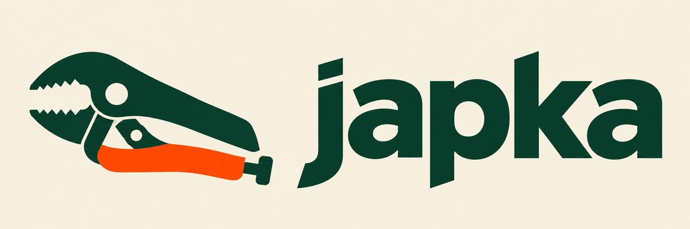

# Japka logo and icon

Japka takes its name from Israeli Hebrew slang for locking pliers (ג׳פקה / ג׳בקה). The mark shows the serrated jaws, the locking lever between the handles, and the adjustment screw at the end of the orange grip.

| Asset | Size | Use |
| --- | --- | --- |
| [Horizontal logo](../public/brand/japka-logo.png) | 1200 × 400 PNG | READMEs, documentation and project introductions |
| [Square icon](../public/brand/japka-icon.png) | 512 × 512 PNG | GitHub organization and Docker Hub avatars |
| [Favicon](../public/brand/favicon.png) | 32 × 32 PNG | Browser tabs |
